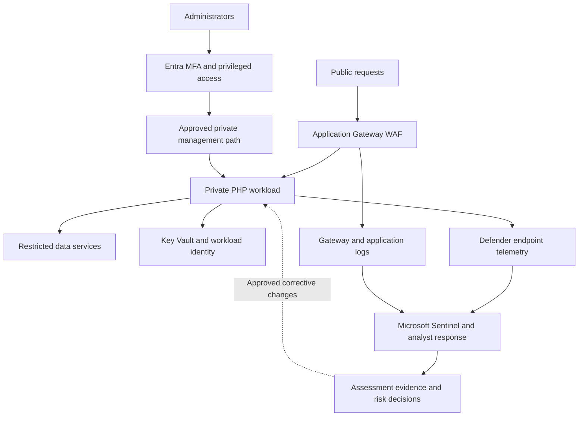

# Azure PHP Zero Trust Architecture

This proposed deployment places the PHP origin behind a controlled entry point, separates administrative access, limits workload permissions, and routes security evidence to monitoring and RMF records.

**Figure 1:** This Azure design limits access to the PHP workload, monitors suspicious activity, and connects verified fixes to RMF evidence.

## Trust boundaries

| Boundary | Required check |
|---|---|
| Internet to gateway | Only approved listeners, policies, and application paths are exposed. |
| Gateway to workload | Direct origins and unnecessary interfaces are restricted. |
| Administrator to workload | Administrative identity, privilege, and management path are verified. |
| Workload to data and secrets | Effective permissions and network access are limited to required operations. |
| Workload to monitoring | Required sources arrive and can support investigation. |
| Evidence to risk decision | Technical conclusions and remaining uncertainty are documented and reviewed. |

Public-request authentication is application-specific. Entra protection for administrators does not automatically protect an unauthenticated PHP parser. The runtime still requires the vendor fix.

## Deployment choices

Use an Azure VM or supported container service according to the actual application. Apply the appropriate OS/platform baseline and record shared responsibilities. This diagram does not imply that a managed platform exposes all host settings or that Intune patches Linux server PHP.

See [Azure integration steps](../11-azure-zero-trust-integration.md) and the editable [Mermaid source](azure-php-zero-trust.mmd).
