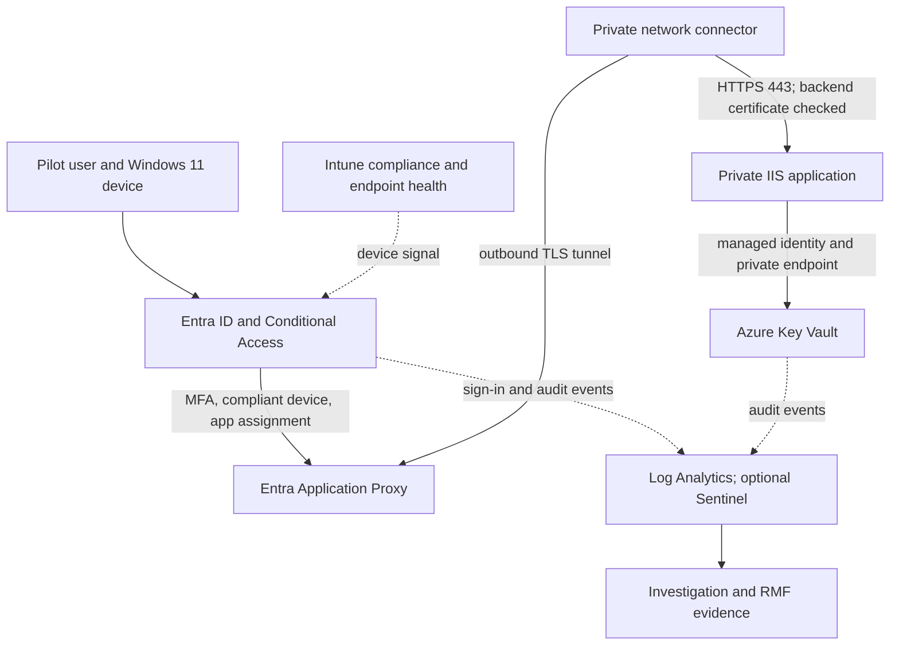
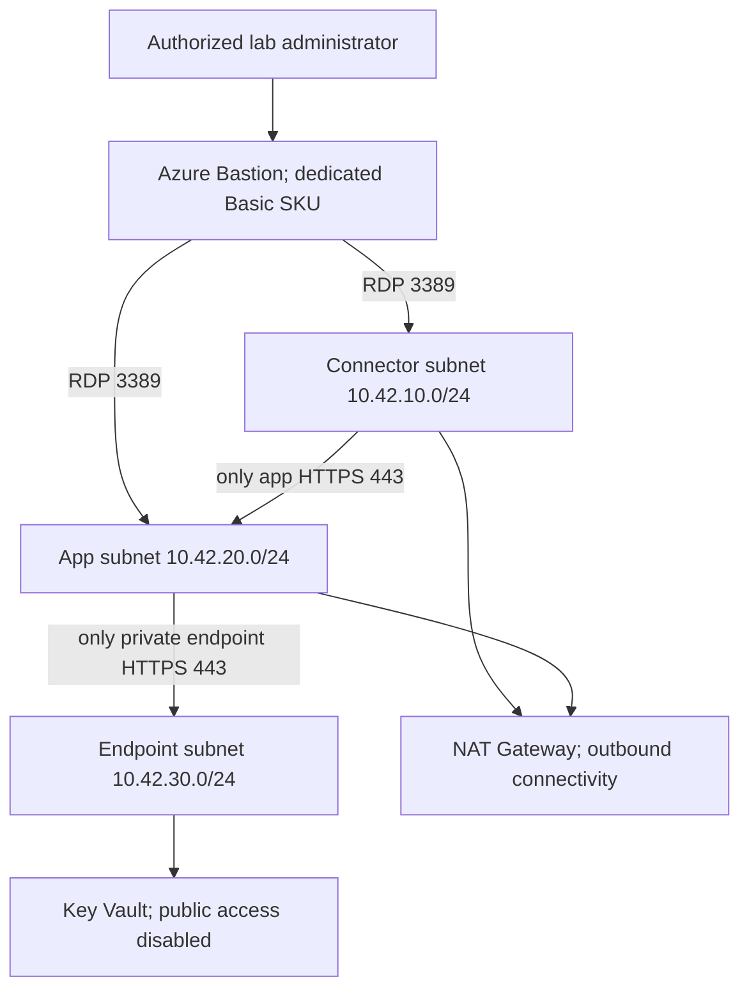

# Azure Zero Trust DEV architecture

## Figure 1 — Protected application access

**Figure 1.** Entra checks the user's identity and device before a private connector reaches the protected application and its demonstration secret.

The connector initiates its cloud connections. An inbound internet connection to the connector or application VM is unnecessary. Application Proxy exposes an authenticated public application URL; the application's backend and the vault remain private. A browser may reach the login page before policy evaluation; that does not prove it can access the application.

The arrow from the application to Key Vault represents the separate managed identity exercise in Step 15. The static IIS page does not retrieve or display vault secrets.

## Access decisions and enforcement

| Decision or signal | Decision point | Enforcement point | Evidence |
|---|---|---|---|
| User identity, MFA, and device compliance | Entra Conditional Access using Intune compliance | Entra token issuance and Application Proxy preauthentication | Sign-in log, policy result, and application access result. |
| Which users may access the app | Enterprise application assignment | Entra application access | Assigned pilot allowed; unassigned licensed test user denied. |
| Connector may contact application on 443 | Explicit ASG and NSG rules | Azure network rules and Windows Firewall | Allowed 443; denied 80 and 3389 from connector. |
| Application may contact vault | Private DNS, private endpoint network rules, and RBAC | Private Link and Key Vault | Private address resolution; allowed read and denied write. |
| Temporary administrator access | Azure RBAC; optional licensed PIM | Azure management plane | Activation, assignment, and Azure Activity records. |

Conditional Access evaluates supported authentication requests and token issuance. Do not describe it as inspection of every network packet or instant invalidation of every existing session. Managed identity calls are workload access; the user-scoped policy does not enforce device compliance on those calls.

## Figure 2 — Network boundaries

**Figure 2.** Separate subnets and explicit network rules limit access to the application and vault while Bastion provides controlled administration.

The foundation reserves `AzureBastionSubnet`, `10.42.40.0/26`. The guide uses dedicated Bastion Basic so the RDP source matches the supplied NSG rules. Developer SKU has different connectivity requirements and is outside this template's tested design path.

## Resource and address plan

| Resource | Name or address | Purpose |
|---|---|---|
| Resource group | `rg-ezta-dev` | Dedicated lab boundary and cleanup scope. |
| Virtual network | `ezta-dev-vnet`, `10.42.0.0/16` | Address space isolated from other environments. |
| Connector VM | `ezta-conn01`, `10.42.10.10` | Outbound Application Proxy connector. |
| Application VM | `ezta-app01`, `10.42.20.10` | Private HTTPS demonstration site. |
| Internal application DNS | `app.ezta.internal` | Private DNS A record for the application. |
| Private endpoint | `ezta-dev-kv-pe`, allocated in `10.42.30.0/24` | Private vault connection. |
| Vault DNS zone | `privatelink.vaultcore.azure.net` | Private vault name resolution. |
| Key Vault | `kv-ezta-dev-<generated suffix>` | Demonstration secret, soft deletion, purge protection, and RBAC. |
| Log Analytics | `ezta-dev-law` | Identity, vault, and management logs after source setup. |
| Application security groups | `ezta-dev-conn-asg`, `ezta-dev-app-asg` | Network membership based on VM NICs. |

`EZTA-DEV-Users` and the other Entra groups hold identities or devices. Azure application security groups hold VM network interfaces. They are different objects and are not interchangeable.

## Allowed and denied paths

| Source | Destination | Result in the intended configuration |
|---|---|---|
| Internet | Connector or app VM on 80, 443, or 3389 | No VM public IP or inbound publishing path. |
| Authenticated assigned pilot on compliant device | Application Proxy URL | Allowed after the pilot policy is enforced and both controls pass. |
| Unassigned user | Application Proxy application | Denied by assignment. |
| Assigned pilot on unmanaged device | Protected application | Denied after enforcement; report-only does not deny it. |
| Bastion subnet | Both VMs on 3389 | Allowed for administration. |
| Connector ASG | Application ASG on 443 | Allowed by explicit NSG rules. |
| Connector ASG | Application on 80 or 3389 | Denied by overriding the default VNet allow rules. |
| Application ASG | Vault endpoint on 443 | Network path allowed; RBAC still required. |
| Connector | Vault endpoint on 443 | Denied by connector outbound and endpoint inbound rules. |
| VMs | Internet on 80 and 443 | Lab exception for installation, updates, and connector services. |

Private endpoint network policies are enabled so the endpoint NSG can apply. NAT provides connectivity, not destination filtering. The broad web egress rule is a recorded lab limitation; a production design needs reviewed destination restrictions, proxy/firewall controls, and resilience.

## Separate Microsoft 365 work

The existing `Directorate Digital Operations Hub — DEV` SharePoint site can later demonstrate data labeling and approvals. It is a separate Microsoft 365 service, does not sit behind this Application Proxy connector, and is not provisioned by these Azure templates. Keep its permissions and any SharePoint-wide Conditional Access changes in a separate tested change.
